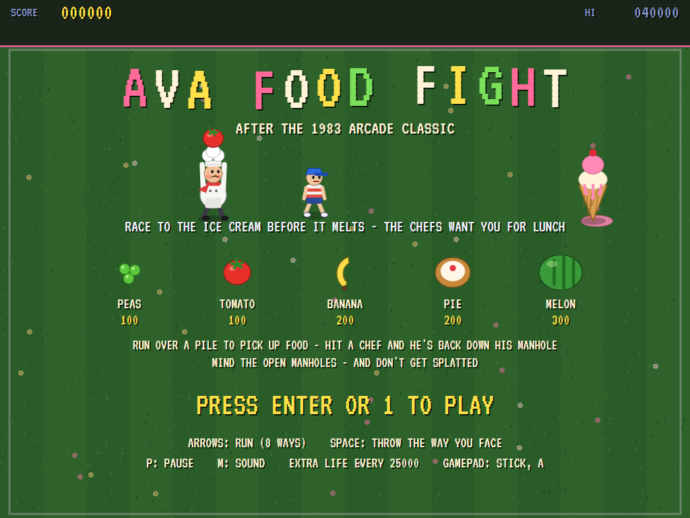
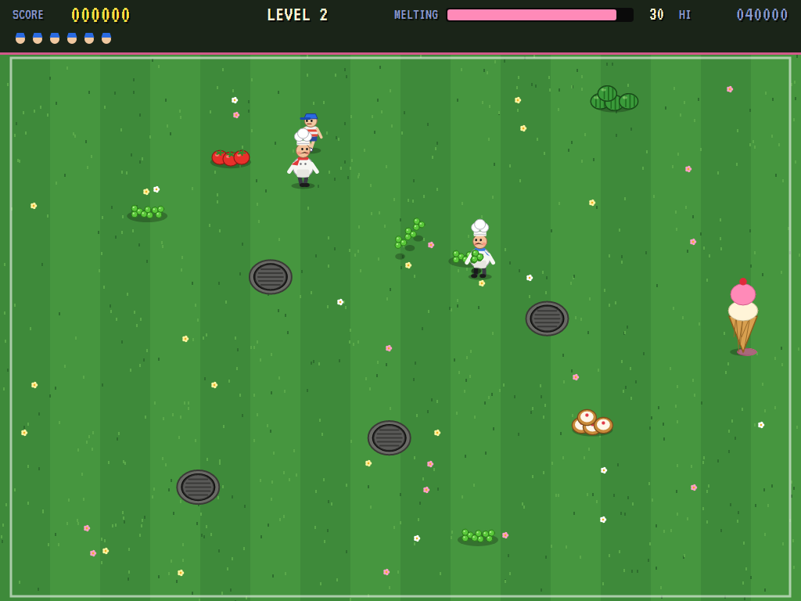
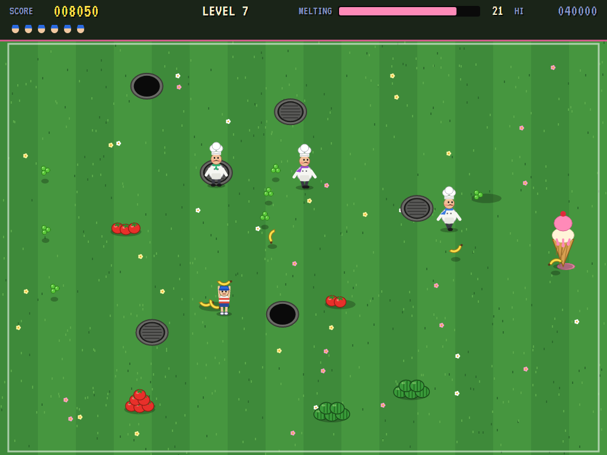
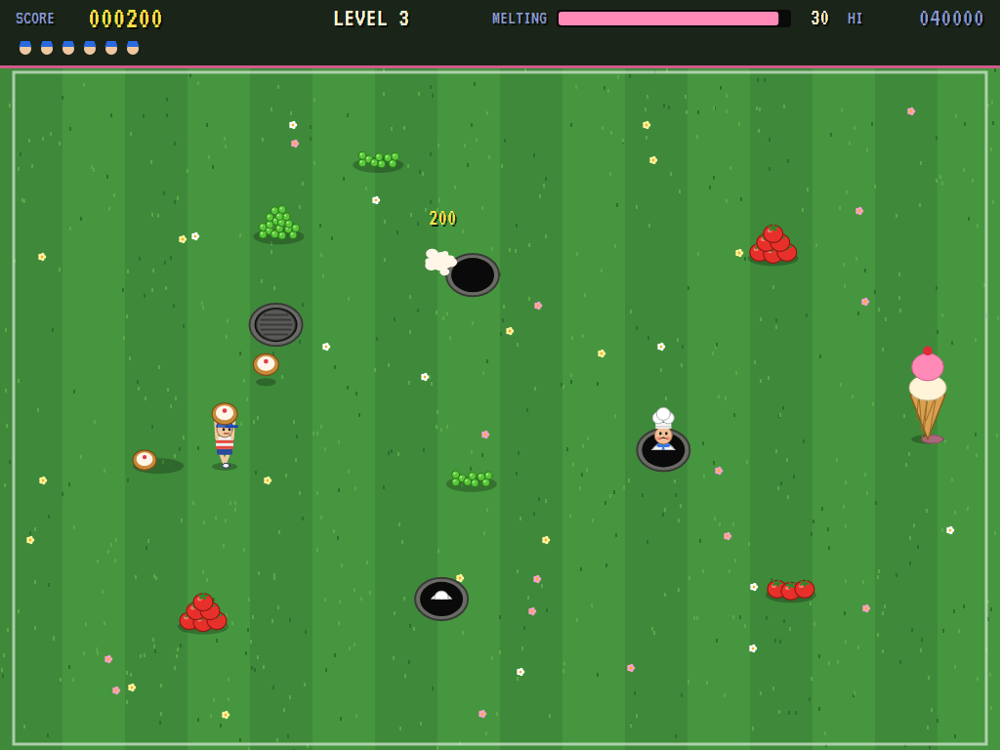
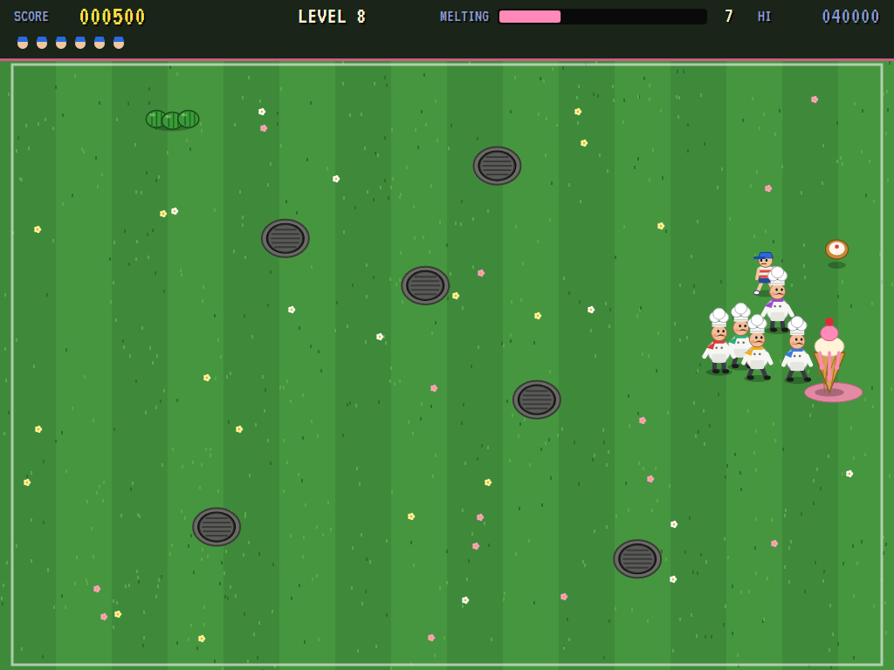
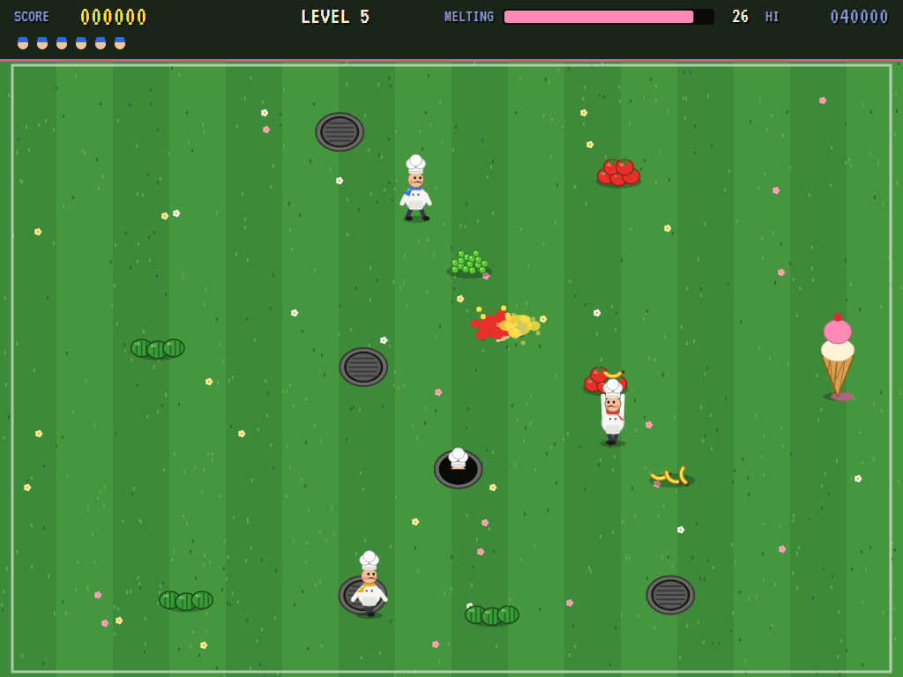
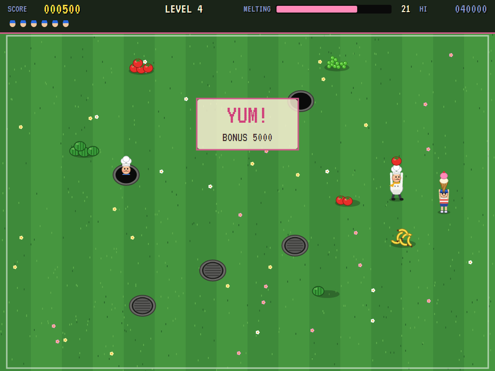
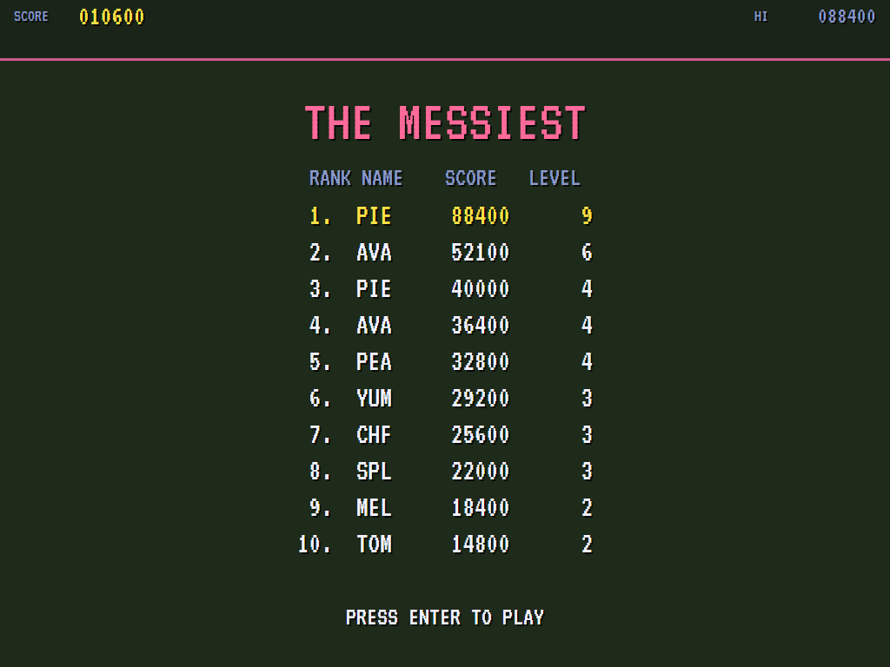

# AVA Food Fight

[](https://github.com/Harlock123/AVAFoodFight/actions/workflows/build.yml)

A food-throwing chase in the style of Atari's 1983 arcade game **Food Fight**, built with .NET 10 and
Avalonia UI. A kid has to get across a lawn to an ice cream cone before it melts. Chefs climb out of the
manholes to stop him. Piles of food lie all over the field: run over one to pick up a handful, then throw it
at any chef who gets in the way. A chef who's hit goes back down his manhole for a while. The chefs throw
food too.

## Features

- **The kid** runs eight ways and throws the way he faces. He carries one thing at a time, and runs over a
  pile to pick something up. An open manhole is the end of him.
- **The food**, by what a hit is worth:
  - **Peas** (100) go as a spray of three.
  - **Tomatoes** (100) and **bananas** (200) fly fast and straight.
  - **Pies** (200) are slower.
  - **Melons** (300) are slowest and biggest.
  - Food meeting food in the air splats both.
- **The chefs** come up out of their manholes one after another:
  - Some chase the kid, each a little off to his own side, closing in at the end.
  - From level 2 the others keep between him and the ice cream, to head him off.
  - They pick up food from any pile they pass, going out of their way for it when he's far off, and throw
    it where he's heading.
  - A hit sends a chef back down his manhole, and he climbs out again a few seconds later.
- **The ice cream** melts as you go: a bar along the top shows how much is left. Reach it in time for a
  bonus of 1000 a level plus 50 for each second left. Let it melt and you lose a life. After a lost life
  the level starts again with the piles full.
- **Each level** is the same field every time you play it. Later levels have more manholes and piles, up to
  five chefs (faster, quicker to throw, and better shots), and an ice cream that melts sooner. There's an
  extra life every 25000.
- **The attract mode** plays itself. The computer player:
  - heads for the ice cream, picking up food on the way when there's time
  - steps sideways to get a chef in line, turns to face him and throws
  - steers round the manholes and the chefs, and gets out of the way of thrown food
  - takes its chances when the ice cream is nearly gone
- **The sounds** are all synthesised: whooshes and splats, slide whistles down the manholes, a slurp at
  the cone, and a bouncy oom-pah tune.

## Screenshots

| The title | A throw | Food both ways |
|:---------:|:-------:|:--------------:|
|  |  |  |
| The food, and the points. | Peas on their way. | Chefs and food in the air. |

| Climbing out | Nearly melted | Splatted |
|:------------:|:-------------:|:--------:|
|  |  |  |
| One chef hit, another coming up. | The chefs guard the cone. | One that got through. |

| Yum | The high scores | |
|:---:|:---------------:|:-:|
|  |  | |
| The ice cream reached. | The messiest. | |

The screenshots are made by the tests, which play the game in a real (headless) window; see
[Tests](#tests).

## Download and run

Ready-to-run builds for Windows, macOS and Linux, on both Intel/AMD and ARM, are on the
[Releases page](https://github.com/Harlock123/AVAFoodFight/releases/tag/latest). **Latest build** is
rebuilt on every push to `main`. Each download is one self-contained executable: no .NET install is
needed.

| Platform | Archive |
|---|---|
| Windows | `AVAFoodFight-win-x64.zip`, `AVAFoodFight-win-x86.zip`, `AVAFoodFight-win-arm64.zip` |
| macOS | `AVAFoodFight-osx-arm64.tar.gz` (Apple silicon), `AVAFoodFight-osx-x64.tar.gz` (Intel) |
| Linux | `AVAFoodFight-linux-x64.tar.gz`, `AVAFoodFight-linux-arm64.tar.gz`, `AVAFoodFight-linux-arm.tar.gz` |

```bash
tar -xzf AVAFoodFight-linux-x64.tar.gz     # or linux-arm64, linux-arm, osx-arm64, osx-x64
./AVAFoodFight
```

On Windows, unzip and run `AVAFoodFight.exe`. On macOS, if Gatekeeper refuses to open it, run
`xattr -d com.apple.quarantine AVAFoodFight` once. Run with `--no-audio` for silence.

**Sound** comes through OpenAL Soft, built in for every platform. In a virtual machine the game
detects it and uses a larger audio buffer, so the sound doesn't break up.

**Gamepads** use SDL2, which is bundled for Windows, macOS and Intel/AMD Linux. ARM Linux builds need it
installed; without it the keyboard still works:

```bash
sudo apt install libsdl2-dev            # Debian / Ubuntu / Raspberry Pi OS
sudo pacman -S --needed sdl2-compat     # Arch / Omarchy
```

## Controls

| Action | Keyboard | Gamepad |
|---|---|---|
| Start | Enter or 1 | Start |
| Run (eight ways) | Arrow keys (or W A S D) | Left stick / D-pad |
| Throw (the way you face) | Space, Z, X, C, Ctrl or Shift | A, B, X or a trigger |
| Pause | P or Esc | Start |
| Quit (while paused) | Esc | Back |
| Sound on/off | M | |
| Screenshot | Ctrl+S (to your Pictures folder) | |

On the high-score table, type your initials, or use up/down and Space, then Enter.

## Tests

```bash
dotnet test AVAFoodFight.slnx
```

The engine has no UI and runs in fixed 60 Hz steps, so it plays the same at any frame rate, and a seed
always plays the same game. The tests check:

- **The field:**
  - every level the same whoever plays it, with manholes and piles clear of each other and of both ends
  - later levels bringing more and faster chefs and a quicker-melting ice cream
  - the chefs starting down their manholes and coming up one after another
- **The kid:**
  - running eight ways at one speed and staying on the field
  - picking up one thing from a pile, and only with empty hands
  - throwing the way he faces, peas going as three, and nothing thrown from empty hands
- **The food:**
  - a hit chef scoring by the food and going back down his manhole for a while
  - a chef still climbing out not being hit
  - food meeting food in the air
- **The chefs:**
  - chasing and catching the kid
  - throwing food at him, and a hit costing a life
  - keeping their food when he's too close or too far
  - picking up food, and standing guard from level 2
- **The ice cream:**
  - an open manhole costing a life
  - reaching the cone for the level and time bonus
  - the ice cream melting, and the piles filling up again after a lost life
- **The machine:**
  - extra lives, the last life, and initials
  - the title, demonstration and high scores, and starting a game
  - the computer player clearing the first three levels, and running blindly at the cone failing

The screenshot tests draw the real screen in a headless window. To refresh the README's pictures:

```bash
FOODFIGHT_SHOTS=$PWD/Images dotnet test tests/AVAFoodFight.Tests --filter ScreenshotTests
```

To see how the computer player gets on, level by level (`1` for the pilot, `lazy` for one that just runs at
the ice cream, weaving and throwing all the time):

```bash
FOODFIGHT_PROBE=1 dotnet test tests/AVAFoodFight.Tests --filter PilotProbe --logger "console;verbosity=detailed"
```

## Building

```bash
dotnet build AVAFoodFight.slnx
dotnet run --project src/AVAFoodFight
```

Needs the .NET 10 SDK. The sounds are made by `tools/make_sounds.py` (standard-library Python):
`python3 tools/make_sounds.py` rewrites `src/AVAFoodFight/Sounds`.

## Project structure

```
AVAFoodFight/
├── AVAFoodFight.slnx
├── src/AVAFoodFight/
│   ├── Engine/
│   │   ├── GameEngine.cs        # States, the title and demo cycle, the music
│   │   ├── GameEngine.Play.cs   # The levels, the kid, the chefs, the food in the air, the ice cream, scoring
│   │   ├── KidPilot.cs          # The computer player, for the demonstration (and the tests)
│   │   ├── Entities.cs          # The field, the foods, piles, manholes, the kid and the chefs
│   │   ├── HighScoreTable.cs, InitialsEntry.cs
│   │   ├── InputHandler.cs, ControllerManager.cs  # Keys and an SDL2 gamepad
│   │   └── SoundManager.cs      # Effects and the tunes through OpenAL
│   ├── Audio/                   # The OpenAL engine (from the author's AVABand)
│   ├── Views/                   # The drawing: the lawn, the kid, the chefs, the food and the screens
│   └── Sounds/                  # The synthesised effects and tunes
├── tests/AVAFoodFight.Tests/    # Gameplay, screenshot and probe tests
├── tools/make_sounds.py
└── Images/                      # Screenshots
```

## About and licence

AVA Food Fight © 2026 Lonnie Watson, under the [MIT License](LICENSE).

*Food Fight* © 1983 Atari; the name belongs to its current owner. AVA Food Fight is an independent,
unofficial game in its style. Its kid, its chefs, its field and food, its graphics, sounds, tunes and code
are its own; nothing is taken from the arcade machine's program, graphics, sound or music. It is not
affiliated with or endorsed by any rights holder.
